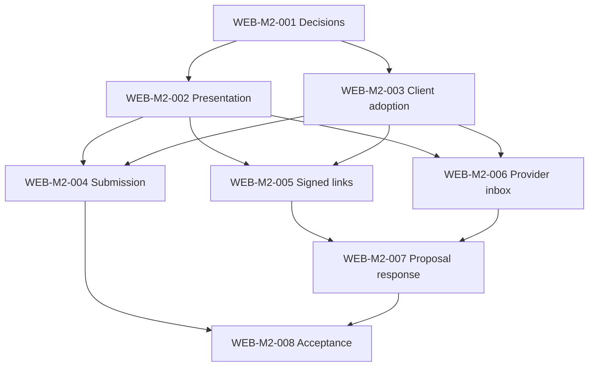

# Web Milestone 2 — Appointment-request experience

- **Status:** PLANNED — tasks WEB-M2-001 through WEB-M2-008 drafted 2026-11-13 from `build-plan.md` and the current implementation. Owner authorization to start Milestone 2 and the WEB-M2-001 decisions are not recorded yet.
- **Direction:** Minimal request form, consent, confirmation states, signed cancellation flow, provider decisions and safe email-linked pages, as described in `build-plan.md`.
- **Milestones 0 and 1:** Formal acceptance of both remains open (see `milestone-0.md` and `milestone-1.md`). Those items stay open and are not blanket prerequisites for Milestone 2 tasks.

## Starting point (inspected 2026-11-13)

Available in this repository:

- Public profile `/[locale]/doctors/[slug]` and directory `/[locale]/doctors`, server-rendered, anonymous, `no-store`, with safe unavailable states (`src/lib/api/public-profile.ts`, `src/lib/api/public-directory.ts`).
- Provider area behind the Google session with the server-only session/CSRF transport (`src/lib/api/session-transport.ts`), Origin-checked Server Actions, stale-revision handling and the guided onboarding checklist.
- Administrator review pages, typed mk/en/bg/sq dictionaries, shared UI primitives, the isolated Playwright API fixture (`tests/e2e/api-fixture.mjs`) and the edge integration harness.
- Caddy access logs delete the `request` field, so request URIs are not logged at the edge today.

Not available:

- **No appointment-request capability in any client.** `package.json` and the lock file pin `@dadzhioski/professional-services-api-client@0.7.0`; the newest published client inspected is 0.9.0 (used by the unmerged WEB-M1-016 branch). Neither contains an appointment-request, consent, signed-link, proposal or notification method or model.
- **No API Milestone 2 tasks.** The sibling API repository has tasks only up to API-M1-014. Its build plan describes Milestone 2 as "request submission, status transitions, proposals, signed links, email delivery, consent records, rate limits, and abuse protection". Every data-backed task below is blocked until the API owner creates and delivers the linked tasks.
- No `src/features/appointment-request` code, routes, translations or fixture routes exist.

Open items carried in from Milestone 1 that affect Milestone 2 work:

| Item | Effect on Milestone 2 |
|---|---|
| WEB-M1-016 (free-text qualifications, client 0.9.0) is implemented on its branch but not merged to `main` | WEB-M2-003 upgrades from whatever `main` pins at that time; merge 016 first to avoid two competing client upgrades |
| WEB-M1-019 (visual refresh) is on its branch, not merged | WEB-M2-002 builds on its design tokens and primitives; merge 019 first |
| `scripts/edge-container-exception.json` (go-jose v3 in Caddy) expired 2026-11-11 | The edge image scan fails until it is remediated or the owner approves an extension; blocks edge validation and releases, not task planning |
| Local `node_modules` holds client 0.9.0 while the lock file pins 0.7.0 | Run `npm ci` before relying on local type checks on `main` or WEB-M1-019 |
| Live API, Google, media and non-production checks from WEB-M1-012 are unexecuted | WEB-M2-008 does not close them; they stay Milestone 1 obligations |

## Task backlog

Use [the task template](../tasks/TASK-TEMPLATE.md) conventions and assign one task at a time.

| Task | Outcome | Dependencies |
|---|---|---|
| [WEB-M2-001](../tasks/WEB-M2-001-appointment-request-decisions.md) | Owner decisions and a Proposed ADR for request data, consent, routes, signed links and abuse boundaries | None |
| [WEB-M2-002](../tasks/WEB-M2-002-request-form-and-state-presentation.md) | Accessible request form and request-state components with synthetic content, not routed publicly | WEB-M2-001 experience decisions; WEB-M1-019 merged |
| [WEB-M2-003](../tasks/WEB-M2-003-appointment-client-adoption.md) | Exact published client with appointment-request capability adopted, with a capability matrix | Published API Milestone 2 client; explicit upgrade approval; WEB-M1-016 merged |
| [WEB-M2-004](../tasks/WEB-M2-004-public-request-submission.md) | A visitor submits a request from a public profile with consent and sees a confirmation state, without JavaScript | WEB-M2-001, 002, 003 (submission capability) |
| [WEB-M2-005](../tasks/WEB-M2-005-signed-link-status-and-cancellation.md) | A visitor opens an emailed signed link, sees the request status and cancels it safely | WEB-M2-001 signed-link decisions; 002; 003 (signed-link capability) |
| [WEB-M2-006](../tasks/WEB-M2-006-provider-request-inbox-and-decisions.md) | A doctor lists requests and confirms, declines or proposes another time | WEB-M2-001; 002; 003 (provider capability) |
| [WEB-M2-007](../tasks/WEB-M2-007-visitor-proposal-response.md) | A visitor accepts or declines a proposed time through a signed link | WEB-M2-005, 006; 003 (proposal capability) |
| [WEB-M2-008](../tasks/WEB-M2-008-milestone-acceptance.md) | Evidence for the visitor-to-doctor request journey | WEB-M2-004 through 007 |

### Execution paths

- WEB-M2-001 and WEB-M2-002 need no API capability and can start as soon as the owner authorizes Milestone 2.
- WEB-M2-003 may be amended for incremental client releases. Each of 004, 005, 006 and 007 is gated only on its own capability, so submission can ship before provider decisions if the API delivers in that order.
- 004, 005 and 006 are independent of each other after 002 and 003. Only one task at a time may change Caddy or deployment files; none is expected to.

## API work to request

This repository does not create or edit API tasks. The API owner is asked to create linked Milestone 2 tasks covering the behavior below; the web tasks then reference them by ID. Shapes come from the generated client, not from this list.

| Needed behavior | Web consumer |
|---|---|
| Anonymous request submission for a published doctor, with a consent record, field validation codes, and rate-limit and abuse responses the web can tell apart | WEB-M2-004 |
| A way for the API to apply per-visitor limits when the web submits server-side (see WEB-M2-001 decision 7) | WEB-M2-004 |
| Signed-link read of a request's visitor-safe status, and signed cancellation that does not act on `GET` | WEB-M2-005 |
| Email delivery whose links use the web routes and locale agreed in WEB-M2-001 | WEB-M2-005, 006, 007 |
| Provider list/detail of own requests and confirm, decline and propose-another-time transitions with revision checks | WEB-M2-006 |
| Signed visitor response to a proposal | WEB-M2-007 |
| Login return allowlist entries for the new provider request routes | WEB-M2-006 |
| A published client release containing the above | WEB-M2-003 |

## Scope and milestone acceptance

In scope: the request form on public profiles, consent, confirmation, signed status/cancellation/proposal pages and provider decisions. Out of scope unless the owner amends it: patient accounts, calendars or availability, instant booking, payments, reminders, messaging threads, administrator request views, analytics (Milestone 3) and any detailed medical data.

- [ ] Owner authorization for Milestone 2 and the WEB-M2-001 decisions are recorded.
- [ ] Linked API tasks exist and an exact published client provides each consumed capability.
- [ ] A visitor can submit, check and cancel a request without an account or JavaScript; no form solicits detailed medical data.
- [ ] A doctor can confirm, decline or propose another time; the visitor can answer a proposal.
- [ ] Signed-link pages are not indexed or cached, do not leak tokens, and never change state on `GET`.
- [ ] Synthetic success, validation, rate-limit, expiry, stale-revision and outage scenarios pass.
- [ ] Quality and security gates pass for the affected release; no automatic exception extension.
- [ ] Live API, email delivery and non-production checks are separately evidenced or explicitly unexecuted.
- [ ] Owner reviews feature acceptance; Milestone 0 and Milestone 1 open obligations stay open.
